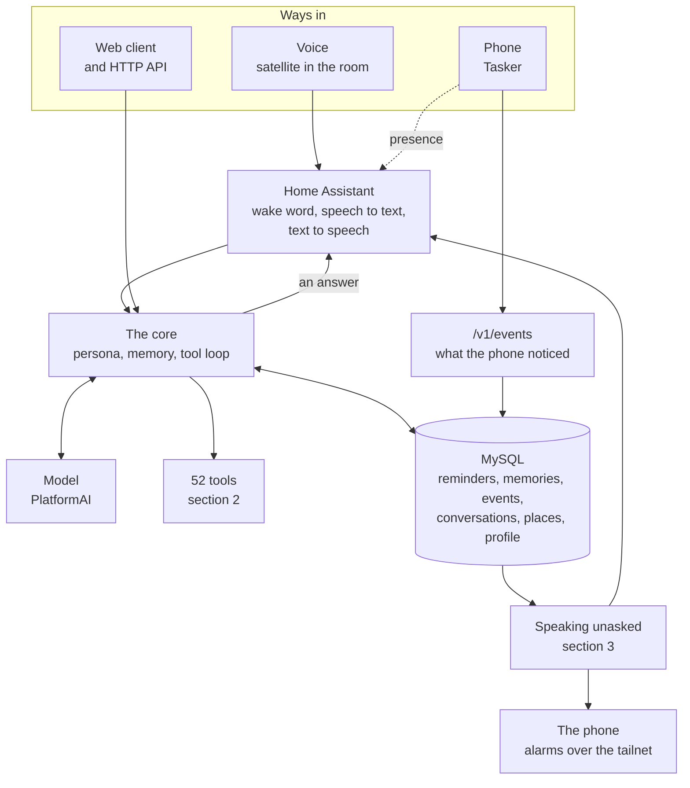
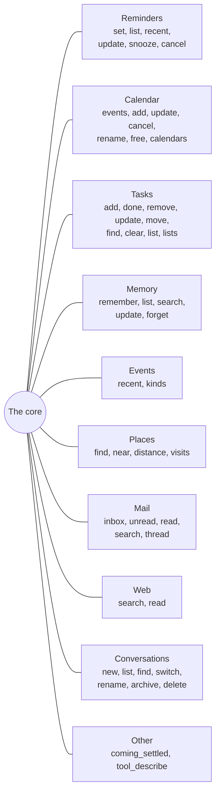
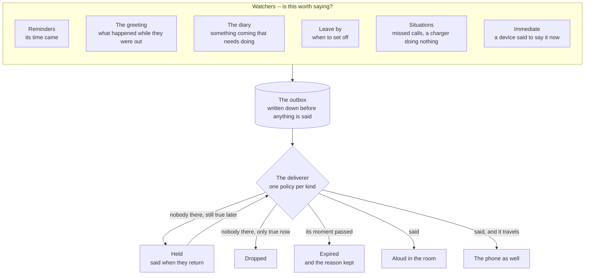
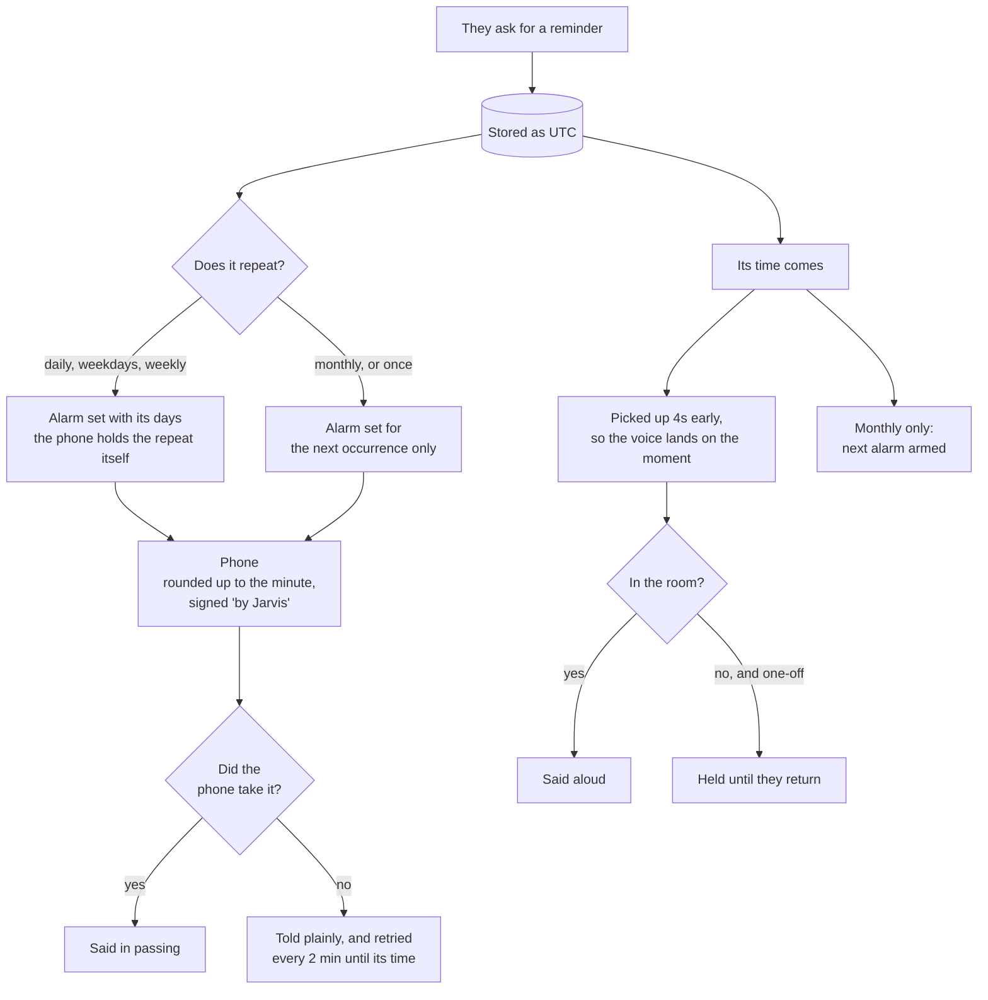

# What Jarvis does

A map of the whole thing, kept current. If you are looking for *why*
something is the way it is, that is [`DEVELOPMENT.md`](DEVELOPMENT.md);
this is only *what exists and how it connects*.

**Keep it current.** A feature added, removed or rewired is changed
here in the same turn, the way a decision is recorded in
DEVELOPMENT.md. A map that lies is worse than no map.

---

## 1. The shape of it

Everything funnels into one core. The voice and the web client are
the same brain with a different mouth, which is why a thing fixed
for one is fixed for both.

---

## 2. What it can do when asked

52 tools, grouped by what they are about. The model picks; nothing
here is keyword matched.

**Where to look first.** Anything about this person's own life is
answered from the calendar, tasks, reminders, events or memory —
never the web, which would send a private name to a stranger. The
web is for the world, not for him.

---

## 3. What it says without being asked

Each of these is its own watcher, and each decides on its own
whether there is anything worth saying. Silence is a valid answer
everywhere here.

**The rule underneath all of it:** nothing is said unless something
asked for it to be said. There is no chatter watcher, by decision —
only the six above.

**Deciding and delivering are separate.** *Is this worth saying* is
genuinely different per watcher and stays with the watcher. *Did it
get said, to whom, and what if it did not* is one job, done once, in
the outbox. Every announcement is written down **before** anything is
spoken, so a server that was off over the moment comes back knowing
what it owes -- and the expiry decides whether it is still worth
saying rather than announcing breakfast at lunchtime.

| kind | nobody there | worth saying for | tries |
|---|---|---|---|
| reminder | held | 1 hour | 5 |
| coming | said anyway, it reaches the phone | 6 hours | 5 |
| immediate | dropped, a device meant *now* | 5 minutes | 3 |
| presence | dropped | 20 seconds | 1 |
| renamed | said anyway, never aloud | 1 hour | 1 |

Only **situations** goes through the outbox so far. The other five
still speak directly, and are being moved over one at a time.

---

## 4. A reminder, end to end

The piece with the most moving parts, so it gets its own picture.

**Cancelling or moving one** takes its alarm with it — unless the
alarm repeats, which Android gives no way to remove from outside.
Then Jarvis says so rather than leaving it to wake them for
something called off.

---

## 5. What it does quietly

Nothing here is ever heard. It is the work that makes the rest
possible.

| every | what |
|---|---|
| a day | **Profile** — a standing description of the person, in prose, from what they said and did |
| a day | **Vocabulary** — the proper nouns they actually say, fed to both speech engines |
| a day | **Forgetting** — raw position readings older than a week |
| always | **Events** — the phone reports what it noticed: battery, calls, apps, music, screen, places |
| always | **Places** — raw fixes settled into arrivals, stays and departures |

---

## 6. What is known to be missing

Kept here so it is not rediscovered.

- Five of the six watchers still speak directly instead of through
  the outbox, so only situations survive a restart or a failure.
- `remark` is a kind nothing can raise any more: the branch that
  chose it is unreachable since unasked remarks were removed.
- The phone answers before it acts, so a successful call is not
  proof the alarm exists.
- A repeating phone alarm cannot be cancelled or moved from here.
- `place.entered home` never fires, and some stay durations are wrong.
- The satellite goes deaf after the laptop suspends.
