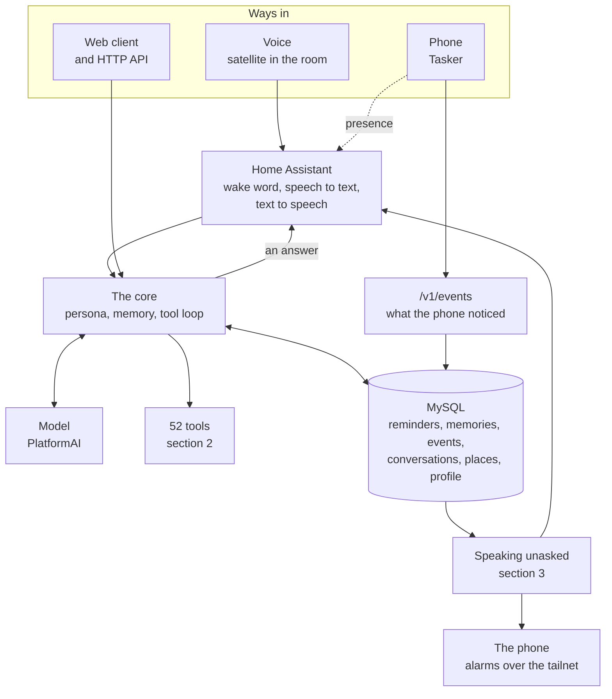
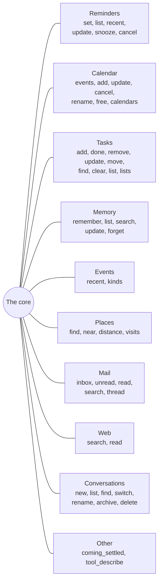
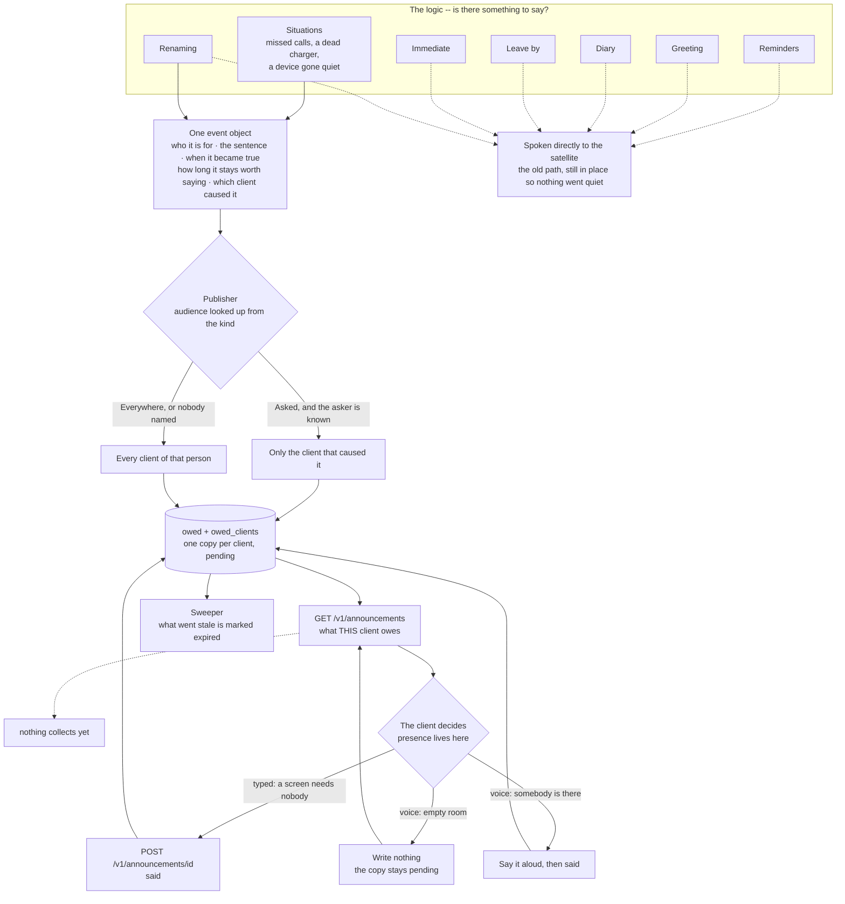
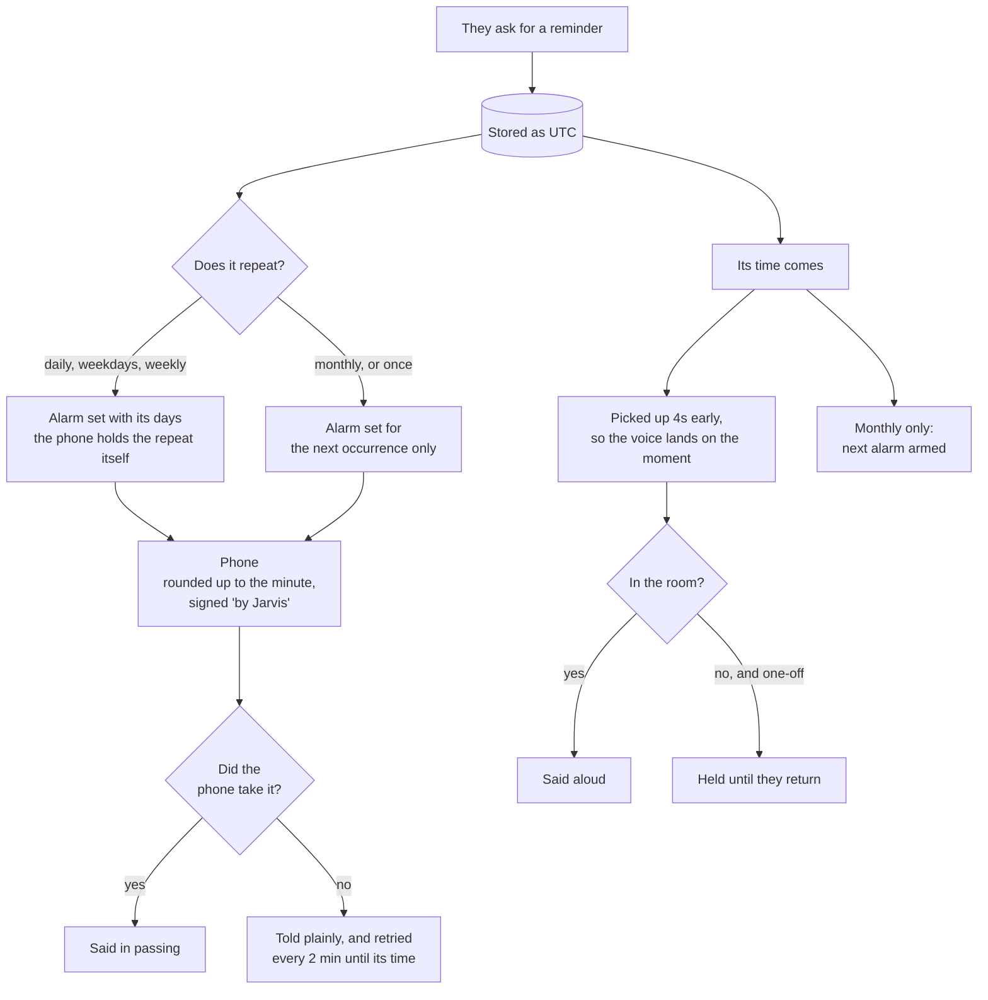
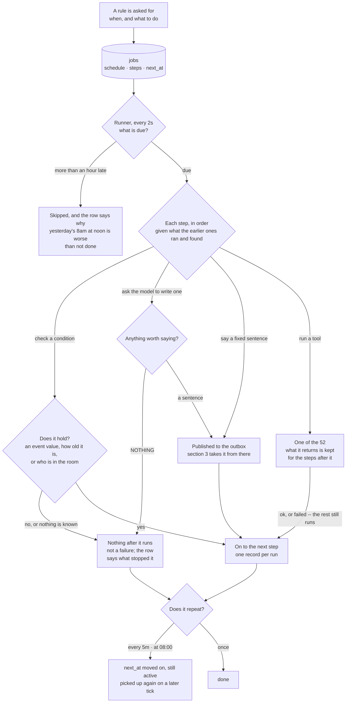

# What Jarvis does

A map of the whole thing, kept current. If you are looking for *why*
something is the way it is, that is [`DEVELOPMENT.md`](DEVELOPMENT.md);
this is only *what exists and how it connects*.

**Keep it current.** A feature added, removed or rewired is changed
here in the same turn, the way a decision is recorded in
DEVELOPMENT.md. A map that lies is worse than no map.

---

## 1. The shape of it

Everything funnels into one core. The voice and the web client are
the same brain with a different mouth, which is why a thing fixed
for one is fixed for both.

---

## 2. What it can do when asked

52 tools, grouped by what they are about. The model picks; nothing
here is keyword matched.

**Where to look first.** Anything about this person's own life is
answered from the calendar, tasks, reminders, events or memory —
never the web, which would send a private name to a stranger. The
web is for the world, not for him.

---

## 3. What it says without being asked

Each of these is its own watcher, and each decides on its own
whether there is anything worth saying. Silence is a valid answer
everywhere here.

**The rule underneath all of it:** nothing is said unless something
asked for it to be said. There is no chatter watcher, by decision —
only the six above.

**The logic and the event object are different things.** Greeting,
renaming, reminders, situations, leave-by and the diary are *logic*:
each watches something different and answers one question, *is there
something to say*. What each produces is the same **event object**,
and everything after that is one path that does not care which logic
made it. The name on it -- reminder, renamed, immediate -- is
provenance, not a species.

**Published once, delivered per client.** An announcement goes into
the outbox before anything is said, and every client of that person
gets its own copy with its own verdict. *Was it announced* is not one
fact about one person: the same warning can be read on a laptop and
missed by a speaker in an empty room, and a single answer could not
say so.

**Presence lives on the client, not the server.** A screen needs
nobody in front of it, so a typed client marks its copy said the
moment it arrives. A voice client knows its own room -- and only it
can -- so it says the announcement or leaves its copy pending and
collects it when the watch comes back. The server keeps no opinion
about rooms.

The server answers the one question a client cannot, because it is
about a moment rather than a device: **has this gone past being
worth saying at all.** Without that, a voice client switched off for
a week comes back to a hundred stale warnings.

| kind | nobody there | worth saying for | tries |
|---|---|---|---|
| reminder | held | 1 hour | 5 |
| coming | said anyway, it reaches the phone | 6 hours | 5 |
| immediate | dropped, a device meant *now* | 5 minutes | 3 |
| presence | dropped | 20 seconds | 1 |
| renamed | said anyway, never aloud | 1 hour | 1 |

`GET /v1/announcements` is what a client collects; `POST
/v1/announcements/{id}` is how it says what it did.

Only **situations** publishes this way so far, and **no client
collects yet** -- so situations are recorded and not heard. The other
five watchers still speak the old way. Both halves are being moved
over one at a time.

---

## 4. A reminder, end to end

The piece with the most moving parts, so it gets its own picture.

**Cancelling or moving one** takes its alarm with it — unless the
alarm repeats, which Android gives no way to remove from outside.
Then Jarvis says so rather than leaving it to wake them for
something called off.

---

## 5. What it does quietly

Nothing here is ever heard. It is the work that makes the rest
possible.

| every | what |
|---|---|
| 2 min | **Watching** — three checks over what the devices reported: somebody trying twice to reach you, a charger doing nothing, and a device that reports every few minutes and has stopped |
| a day | **Profile** — a standing description of the person, in prose, from what they said and did |
| a day | **Vocabulary** — the proper nouns they actually say, fed to both speech engines |
| a day | **Forgetting** — raw position readings older than a week |
| always | **Events** — the phone reports what it noticed: battery, calls, apps, music, screen, places |
| always | **Places** — raw fixes settled into arrivals, stays and departures |

---

## 6. Rules on a schedule

Everything in section 3 is a loop written in Go: a schedule and a
sequence of tasks, with both of them written into a function. This
is the same shape kept in a row instead, so a new rule is something
asked for rather than something built.

**Three ways to write when:** `every 5m`, `at 08:00`, `once
2026-10-07 06:40`. No cron — these are meant to be dictated aloud.

**Four things a step can do:** say a fixed sentence, run one of the
tools that already exist, check a condition, or ask the model to
write the sentence. The verbs were never missing; a rule just needed
a way to point at one.

**A write step is how a rule says something it could not know in
advance.** It carries an instruction rather than words — *say what
the battery has been doing* — and the model turns that plus
whatever the earlier steps found into one sentence. If there is
nothing worth saying it answers `NOTHING`, and then nothing is said
and the rest of the sequence does not run.

The model **gets no tools of its own.** A rule says what to look at
by putting tool steps in front of the write, so what a rule may
reach can be read off the row rather than decided inside a model
call.

**A check is how a rule says *only if*.** It reads one of the three
things the server holds as a value — an event's latest reading, how
long ago that reading came, or whether anybody is in the room — and
stops everything after it when the condition does not hold.

| | |
|---|---|
| `battery.level < 20` | the number the phone last reported |
| `battery.level is not 100` | or the word, when it is not a number |
| `battery.level older than 2h` | the phone has stopped reporting |
| `presence is away` | nobody in the room |

A check as the **first** step is a condition on the whole job; one
in the middle is a condition on what follows. **Nothing known means
it does not pass** — a kind that has never arrived stops the
sequence rather than guessing.

**The schedule says *when*, a check says *whether*.** Which is why
day-of-week is not a check: "at eight on weekdays" is a *when*, and
the schedule grammar is where that will go.

**A sequence is one turn.** Each step is told which tools the ones
before it ran and what they returned, so `[list the task lists, add
a task]` satisfies the read-before-write rule the tools enforce, and
`[read the diary, write a sentence]` has something to write about.
It is a transcript, not variables: nothing compares it or branches
on it, and a check cannot read it.

**Linear, on purpose.** A check stops the steps after it, and that
is the whole of the conditional. No branching, no loops, no
variables — Tasker and Home Assistant already exist for that. A
check reads the world, never the sequence: the moment a condition
could test an earlier step's output, this would need types,
comparison and names for things.

**A reminder is not a special thing here.** It is a job whose steps
are *say the words* and *set the phone alarm*, which is what
`reminder_set` already does inside one function.

**Nothing runs on this yet.** New rules only. The watchers in
section 3 move over one at a time, reminders last.

---

## 7. What is known to be missing

Kept here so it is not rediscovered.

- The job engine runs nothing real yet: the seven watchers are
  still loops in Go. Situations, the diary, leave-by and immediate
  could now be written as rules; greeting and renaming cannot,
  because they are not triggered by a clock — that needs an event
  trigger, which does not exist yet.
- There is no way to create a job by voice, so rules can only be
  inserted directly.
- No client collects its announcements yet, so what situations
  publish is written down and never said. The next step, and the
  one that matters most.
- Five of the six watchers still speak directly rather than
  publishing.
- `Asked` is carrying two different ideas: *only the client that
  caused this*, which a renaming means, and *the room rather than
  the phone*, which an immediate announcement means. A device event
  has no causing client, so it falls through to everybody. Splitting
  the two is the fix.
- `remark` is history only: six were really said, nothing can
  raise one, and the kind exists so those six still load.
- The phone answers before it acts, so a successful call is not
  proof the alarm exists.
- A repeating phone alarm cannot be cancelled or moved from here.
- `place.entered home` never fires, and some stay durations are wrong.
- The satellite goes deaf after the laptop suspends.
