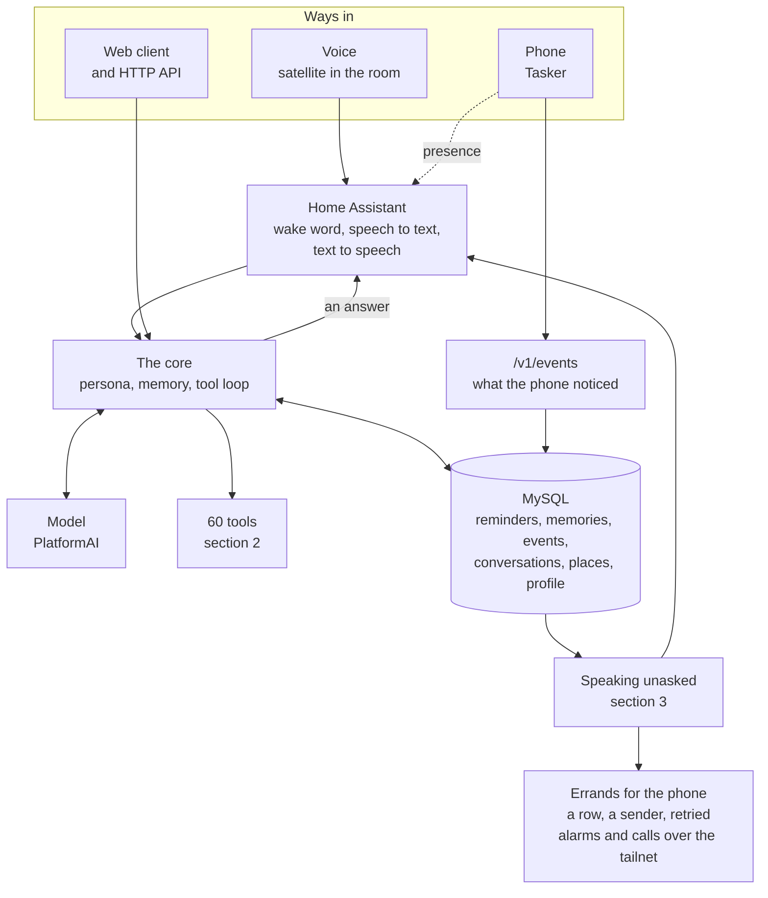
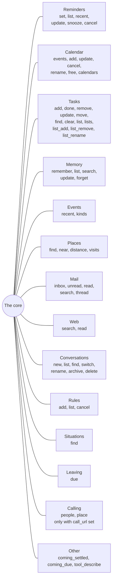
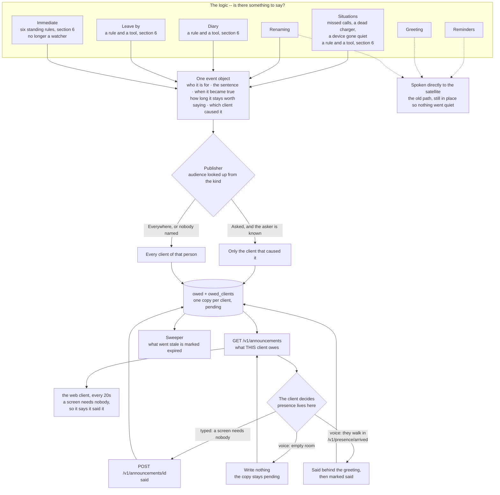
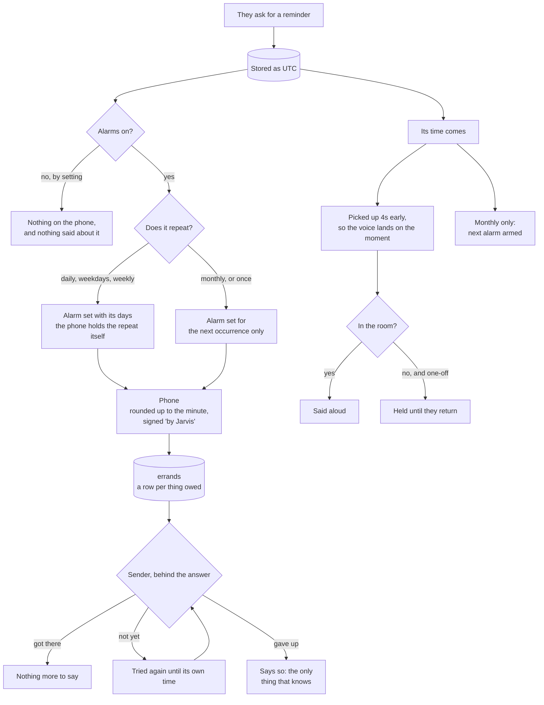
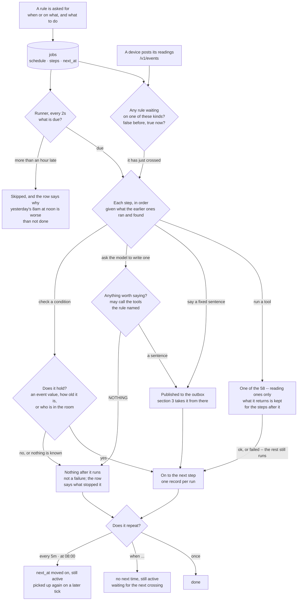

# What Jarvis does

A map of the whole thing, kept current. If you are looking for *why*
something is the way it is, that is [`DEVELOPMENT.md`](DEVELOPMENT.md);
this is only *what exists and how it connects*.

**Keep it current.** A feature added, removed or rewired is changed
here in the same turn, the way a decision is recorded in
DEVELOPMENT.md. A map that lies is worse than no map.

---

## 1. The shape of it

Everything funnels into one core. The voice and the web client are
the same brain with a different mouth, which is why a thing fixed
for one is fixed for both.

---

## 2. What it can do when asked

60 tools, grouped by what they are about. The model picks; nothing
here is keyword matched.

**Two of those are conditional.** `call_people` and `call_place`
are registered only when `[homeassistant] call_url` gives them
somewhere to ring — 58 without it, 60 with, and it is set. A tool
that cannot work is not offered: a model holding one will say it is
ringing somebody and then explain why it could not.

**Where to look first.** Anything about this person's own life is
answered from the calendar, tasks, reminders, events or memory —
never the web, which would send a private name to a stranger. The
web is for the world, not for him.

---

## 3. What it says without being asked

Each of these is its own watcher, and each decides on its own
whether there is anything worth saying. Silence is a valid answer
everywhere here.

**The rule underneath all of it:** nothing is said unless something
asked for it to be said. There is no chatter watcher, by decision —
only the seven above.

**Immediate is no longer one of them.** It was the first to move onto
the engine in section 6: six rows saying `when battery.level < 25`
and so on, instead of a watcher on a thirty-second tick reading
thresholds out of `config.ini`. The thresholds are changed by saying
so now, not by editing a file and restarting.

**The logic and the event object are different things.** Greeting,
renaming, reminders, situations, leave-by and the diary are *logic*:
each watches something different and answers one question, *is there
something to say*. What each produces is the same **event object**,
and everything after that is one path that does not care which logic
made it. The name on it -- reminder, renamed, immediate -- is
provenance, not a species.

**Published once, delivered per client.** An announcement goes into
the outbox before anything is said, and every client of that person
gets its own copy with its own verdict. *Was it announced* is not one
fact about one person: the same warning can be read on a laptop and
missed by a speaker in an empty room, and a single answer could not
say so.

**Presence lives on the client, not the server.** A screen needs
nobody in front of it, so a typed client marks its copy said the
moment it arrives. A voice client knows its own room -- and only it
can -- so it says the announcement or leaves its copy pending and
collects it when the watch comes back. The server keeps no opinion
about rooms.

The server answers the one question a client cannot, because it is
about a moment rather than a device: **has this gone past being
worth saying at all.** Without that, a voice client switched off for
a week comes back to a hundred stale warnings.

| kind | nobody there | worth saying for | tries |
|---|---|---|---|
| reminder | held | 1 hour | 5 |
| coming | said anyway, it reaches the phone | 6 hours | 5 |
| immediate | dropped, a device meant *now* | 5 minutes | 3 |
| presence | dropped | 20 seconds | 1 |
| renamed | said anyway, never aloud | 1 hour | 1 |

`GET /v1/announcements` is what a client collects; `POST
/v1/announcements/{id}` is how it says what it did.

Only **situations** publishes this way so far, and **no client
collects yet** -- so situations are recorded and not heard. The other
five watchers still speak the old way. Both halves are being moved
over one at a time.

---

## 4. A reminder, end to end

The piece with the most moving parts, so it gets its own picture.

**Cancelling or moving one** takes its alarm with it — unless the
alarm repeats, which Android gives no way to remove from outside.
Then Jarvis says so rather than leaving it to wake them for
something called off.

**Putting one off asks for a second alarm** at the new time rather
than moving the first. There is no snooze on a phone alarm that
anything here can reach.

**Nothing waits on the phone.** Asking for an alarm writes a row;
one sender gets it there, in order, retrying, and survives a
restart. The second and a half the phone's clock needs between
forgetting one alarm and being told the next is a timestamp on the
row, not a pause in the conversation. If it never gets there, the
sender says so — that is the only thing that knows.

**Alarms can be turned off** with `[assistant] alarms`, which is
true by default. Off is silent; *no phone configured* is a fault
and is said.

### Ringing somebody

*"Call Amma."* The phone dials, not the laptop.

**It goes by name, never a number.** Jarvis has no address book: the
name travels to the phone and the phone looks it up in its own
contacts. So a contact saved this morning works without an import,
nobody else's telephone numbers sit on this server, and the only
people reachable are the ones already in the phone. A number given
out loud is refused and he is asked whose it is.

**He knows who to offer** from the calls the phone has reported —
every one names who it was with — so a name that came out of
speech-to-text wrong is matched against the people really called.
Somebody never called before is still rung; the list is for matching,
not for gatekeeping.

**Nothing is ever dialled without being asked first.** The owner's
rule, in his words: *confirm always*. The first call dials nothing at
all — it comes back with the question and a word only the server
could have made. The call is placed only when that word comes back
*and* he has said something since it was issued, because a question
asked and answered in the same breath is Jarvis agreeing with
himself. So calling is always two turns.

A name that merely sounds close is put to him even then — the thing
needing agreement is *which person* — and agreeing to ring one person
never rings another.

**It expires after two minutes.** A call that connects ten minutes
late, in a meeting, is worse than one that never went — so if the
phone could not be reached, he is told that instead.

---

## 5. What it does quietly

Nothing here is ever heard. It is the work that makes the rest
possible.

| every | what |
|---|---|
| 2 min | **Watching** — three checks over what the devices reported: somebody trying twice to reach you, a charger doing nothing, and a device that reports every few minutes and has stopped |
| an hour | **Profile** — a standing description of the person, from what they said, what their devices reported, and what they had planned. Three parts, written one model call each; a part that fails keeps what it said last time |
| a day | **Vocabulary** — the proper nouns they actually say, fed to both speech engines |
| a day | **Forgetting** — raw position readings older than a week |
| always | **Events** — the phone reports what it noticed: battery, calls, apps, music, screen, places |
| always | **Places** — raw fixes settled into arrivals, stays and departures |
| 30 s | **Errands** — what is owed to the phone, got there in order and retried |

---

## 6. Rules on a schedule

Everything in section 3 is a loop written in Go: a schedule and a
sequence of tasks, with both of them written into a function. This
is the same shape kept in a row instead, so a new rule is something
asked for rather than something built.

**Four ways to say when:** `every 5m`, `at 08:00`, `once 2026-10-07
06:40`, and `when battery.level < 20`. No cron — these are meant to
be dictated aloud.

**The last one is not a time at all.** It has no next run, so the
clock never picks it up; it runs the moment a reading arrives that
makes it true. That is the only way to say *when I get home* or
*when the battery drops*, neither of which happens at an hour
anybody knows in advance.

It fires on the **crossing**, not on the condition holding. A phone
at fifteen per cent says so every few minutes; the reading before
this one is read too, and the rule runs only where the condition
was false then and true now. So it also never fires on the first
reading of a kind the server has never seen — nothing known, no
crossing proved.

A trigger is narrower than a check: it must name something that
*arrives*. Not presence, which is asked of Home Assistant rather
than reported, and not `older than`, which could never be true at
the moment a reading lands.

**A tool can end a sequence too**, by answering `NOTHING` — the
same word a write step uses for it. That is what lets a rule look
for something every two minutes without asking a model to say
nothing seven hundred times a day: the looking is cheap and
deterministic, the sentence is neither.

**Five things a step can do:** say a fixed sentence, run one of the
tools that already exist, check a condition, or ask the model to
write the sentence. The verbs were never missing; a rule just needed
a way to point at one.

**A relay step says what the tool before it returned, as it
stands, with no model.** For a tool that has already settled the
words — the diary works out its own sentence when it judges an
entry, often weeks before saying it. *Write is for when the words
do not exist yet; relay is for when they do.*

**A write step is how a rule says something it could not know in
advance.** It carries an instruction rather than words — *say what
the battery has been doing* — and the model turns that plus
whatever the earlier steps found into one sentence. If there is
nothing worth saying it answers `NOTHING`, and then nothing is said
and the rest of the sequence does not run.

**A rule can be given tools of its own.** It names which ones, and
the model decides whether to call them and with what arguments
against the question actually in front of it — because a rule
written on Monday cannot know what Thursday needs. Named rather
than open, so what a rule may reach is still readable off the row;
reading tools only, checked when written and again when it runs;
four rounds, then silence.

Two ways of looking, kept apart: `look_up` runs tools *before* the
model is asked anything and hands over what they said — one round
trip fewer, and deterministic — while `tools` lets it choose. A
rule may have both.

**A check is how a rule says *only if*.** It reads one of the three
things the server holds as a value — an event's latest reading, how
long ago that reading came, or whether anybody is in the room — and
stops everything after it when the condition does not hold.

| | |
|---|---|
| `battery.level < 20` | the number the phone last reported |
| `battery.level is not 100` | or the word, when it is not a number |
| `battery.level older than 2h` | the phone has stopped reporting |
| `presence is away` | nobody in the room |

A check as the **first** step is a condition on the whole job; one
in the middle is a condition on what follows. **Nothing known means
it does not pass** — a kind that has never arrived stops the
sequence rather than guessing.

**The schedule says *when*, a check says *whether*.** Which is why
day-of-week is not a check: "at eight on weekdays" is a *when*, and
the schedule grammar is where that will go.

The same condition can be either. As a schedule it is the trigger
and fires on the crossing; as a check it is a gate and is asked
each time the rule runs. `when the battery drops below 20` and `at
8am, if the battery is below 20` are both sayable, and mean
different things.

**A sequence is one turn.** Each step is told which tools the ones
before it ran and what they returned, so `[list the task lists, add
a task]` satisfies the read-before-write rule the tools enforce, and
`[read the diary, write a sentence]` has something to write about.
It is a transcript, not variables: nothing compares it or branches
on it, and a check cannot read it.

**A rule does not say the same thing twice.** It is told what it
said last time and asked whether what it has now is the same news;
if it is, it says nothing. The memory is kept while the thing is
still true and forgotten when a check stops holding, so something
that goes away and comes back is announced again.

**He writes his own rules.** On the hourly pass, after the
description is rewritten, he is shown what he knows and the rules he
already keeps, and may ask for one rule in a sentence -- which goes
to the same writer the tools use and is refused if it will not hold.
One a day at most, six hours apart, kept as its own kind (`noticed`)
with the reason on the rule. Almost always he asks for nothing,
which is the point.

**And memories can become wrong.** On the same pass, where a later
memory plainly replaces an earlier one -- where they live, what
something is called -- the older is set aside with the reason kept
on the row, and stops reaching the model. Preferences are never
superseded: liking a new song does not stop them liking the old one.

**And retires them.** On the same pass, before writing another, he
may take back one of his own -- only his, only after a week, only an
id he was shown, and cancelled rather than deleted so the record
survives. A rule that has never fired is usually a rule for
something rare, so the instruction is written to keep.

**What is trending.** Four lengths of time -- today, this week, this
month, this year -- each against the one before it, over every kind
and value, reporting only what arrived, stopped, doubled or halved.
A window is reported only where a whole one of itself precedes it,
so a young database stays quiet rather than calling everything new.

**The same habit at three distances.** Where today or this week sits
oddly against the four-week habit, the description says so --
*"usually around 9pm, today at midnight"* -- and says nothing where
the hour is ordinary. A habit with no usual hour is never late.

**Patterns, for what the grammar cannot say.** A condition may ask
a named shape instead of reading a source:

    {"pattern": "reaching", "with": {"tries": 2}}

A shape is worked out in Go, tested, and given blanks a rule fills
in. It exists for questions no arrangement of counting and windows
reaches: `reaching` is "somebody has tried twice **and still not got
through**", and the second half is a thing that *cancels* the ones
before it, which counting cannot express. Its blanks are `tries`
(default 2), `among` (one person, default anybody) and `within`
(default 3h).

Asked plainly it means it holds; `"op": "==", "value": "no"` is the
absence. A pattern cannot *wake* a rule — it is worked out from
events that already landed, so a rule standing only on one would
wait for ever. Give it a clock or an arriving event, and ask the
pattern as a condition.

Shapes now: **reaching** and **still** (`on`, `off`, `is` -- which
of two kinds happened last, for "connected and not disconnected
since"). The others named when this was scoped --
cancelled-by, gone-quiet -- turned out not to need their own:
`reaching` *is* the cancelled-by shape, and gone-quiet falls out of
counting (`counted battery.level within 30m is 0`).

**It can wait.** An act may be `{"do": "wait", "for": "5m"}`, and
everything after it runs when that time is up. *"Say it, give it
five minutes, look again"* is a whole thought.

Not a sleep. One pass runs every due rule on one goroutine, so a
rule that slept would stop all of them; it stops instead, records
where it got to, and the next pass after that moment picks it up.
So a wait is accurate to within a tick, which is all anything here
needs. It must have something after it, and the conditions are
**not** asked again on the way back -- they held when the sequence
began, and re-asking would quietly turn "wait five minutes" into
"wait five minutes and check nothing changed".

**Linear, on purpose.** A check stops the steps after it, and that
is the whole of the conditional. No branching, no loops, no
variables — Tasker and Home Assistant already exist for that. A
check reads the world, never the sequence: the moment a condition
could test an earlier step's output, this would need types,
comparison and names for things.

**A reminder is not a special thing here.** It is a job whose steps
are *say the words* and *set the phone alarm*, which is what
`reminder_set` already does inside one function.

**Rules are made by speaking.** `rule_add`, `rule_list`,
`rule_cancel` — *"every morning at seven thirty, look at my calendar
and tell me what is coming up"* becomes `at 07:30` with
`[calendar_events, write]`, and *"whenever my battery drops below
fifteen, tell me how fast it is draining"* becomes `when
battery.level < 15` with `[event_recent, write]`.

A rule may only **read**. A tool that changes something is refused:
a rule runs unattended and possibly every few minutes, and nobody is
there to notice the first time it goes wrong.

**The first watcher has moved.** `internal/notice` was a
thirty-second tick, a threshold table in `config.ini` and a
presence gate; it is now six rows:

| rule | and then |
|---|---|
| `when battery.level < 25` | only if still ≥ 20 → read the recent readings → write a sentence |
| `when battery.level < 20` | only if still ≥ 15 → … |
| `when battery.level < 15` | only if still ≥ 10 → … |
| `when battery.level < 10` | only if still ≥ 5 → … |
| `when battery.level < 5` | → … |
| `when battery.level is 100` | → write a sentence |

Each band is **bounded below by a check**, so a phone coming back
from being switched off at four per cent crosses all five lines at
once and still says one thing, not five. The old watcher said
nothing at all in that case, because it matched the exact value.

**Every run is written down** — what it was, whether it spoke, what
it said, and why it did not. That is the same record `/v1/remarks`
already showed, so the page did not change and now covers every
rule rather than one watcher.

The rest of section 3 is still loops in Go and moves over one at a
time, reminders last — except greeting and renaming, which are
staying where they are.

---

## 7. What is known to be missing

Kept here so it is not rediscovered.

- Three of the seven watchers are still loops in Go: reminders,
  greeting and renaming. Immediate, situations, the diary and
  leave-by have moved. Greeting and renaming are not moving;
  reminders move last, so the engine's share is done.
- Leave-by forgets what it has already said when the server
  restarts. Its memory is a map in the process, as it was before
  the move; the sentence counts down, so nothing comparing words
  can replace it.
- **Greeting and renaming are not moving, by decision.** They stay
  as they are. Neither is a standing rule, and neither would be
  better as one — see DEVELOPMENT.md. Four producers are in scope,
  not six.
- The phone does not collect. Tasker holds a client and a copy is
  written for it every time; nothing has ever read one. It is not
  a speaking client, so nothing is lost today.
- A live arrival has not yet proved the voice collector. The
  logic is tested through the route; the next time somebody walks
  in will prove the rest.
- Reminders and the greeting still speak directly rather than
  publishing. Everything on the engine publishes, because the
  engine does.
- `Asked` is carrying two different ideas: *only the client that
  caused this*, which a renaming means, and *the room rather than
  the phone*, which an immediate announcement means. A device event
  has no causing client, so it falls through to everybody. Splitting
  the two is the fix.
- `remark` is history only: six were really said, nothing can
  raise one, and the kind exists so those six still load.
- The phone answers before it acts, so a successful call is not
  proof the alarm exists.
- A snoozed reminder leaves two alarms on the phone with the same
  label, and `Clear` dismisses by label. Whether Android removes
  one or both is untested.
- A repeating phone alarm cannot be cancelled or moved from here.
- Geofence crossings are missed, not absent. Over five days:
  entered home 4 against exited home 5, entered office 3 against
  exited office 3. The note here said `place.entered home` never
  fires, which the events disprove — it fires and sometimes does
  not. Several arrive in backlog flushes, dozens sharing one
  received_at, so the phone is spooling them rather than losing
  them.
- A stay longer than 36 hours stops being amended once it outgrows
  the settling window, so an unbroken fortnight at home reads as
  36 hours.
- The satellite goes deaf after the laptop suspends. A separate
  cause from the playback wedge, which is fixed.
